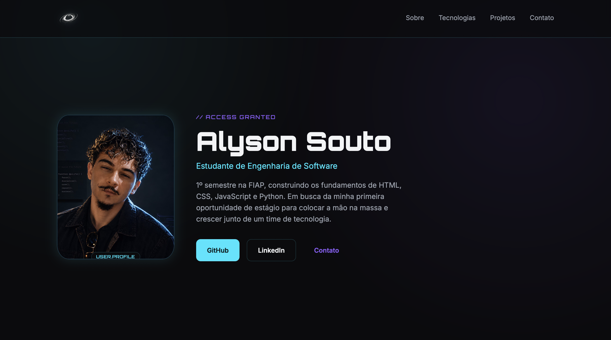
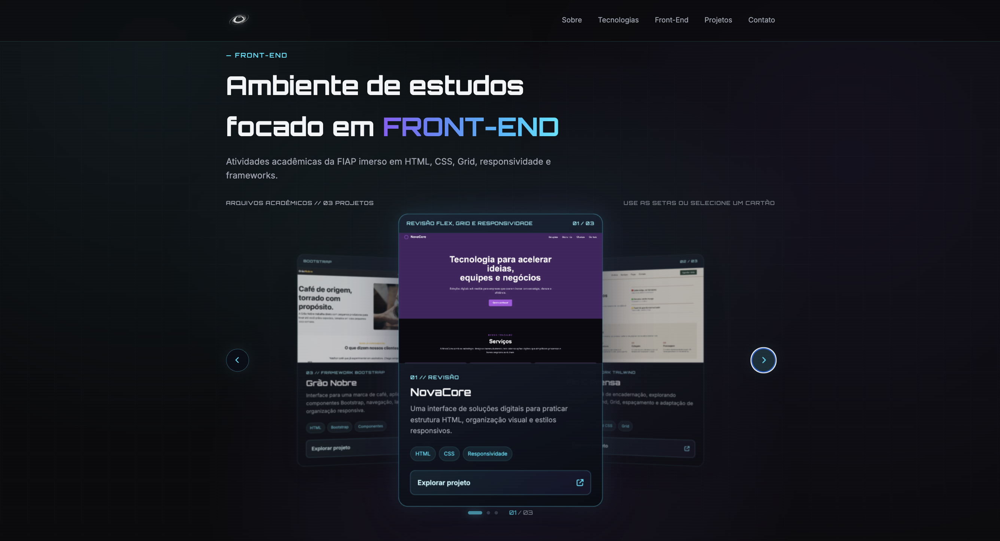
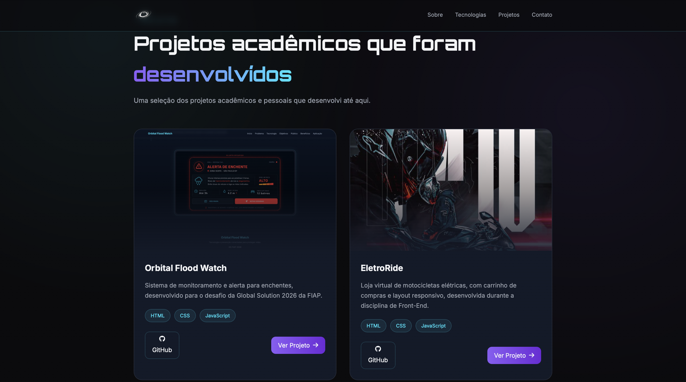

<div align="center">

# ⚡ Alyson Souto

### Software Engineering Student • Front-end Developer


> "Transformando aprendizado em projetos reais."

[](https://github.com/alyson-souto/portf-lio)
[](https://www.linkedin.com/in/alyson-souto-739039314/)


</div>

---

# SYSTEM STATUS

```txt
> Booting Portfolio...
> Loading profile...
> Loading technologies...
> Loading projects...
> Authentication Complete.
> ACCESS GRANTED
```

---

# 📌 Sobre

Este é meu portfólio pessoal desenvolvido para apresentar minha trajetória,
habilidades e projetos acadêmicos durante a graduação em Engenharia de Software.

O objetivo foi criar uma interface moderna inspirada em sistemas futuristas,
misturando design minimalista, efeitos neon e uma experiência semelhante a um
HUD (Heads-Up Display).

---

# ✨ Demonstração

<p align="center">



</p>

<p align="center">



</p>

<p align="center">



</p>

---

# 🚀 Tecnologias

<p align="center">


</p>

---

# 🛰 Funcionalidades

✔ Tela de Boot animada

✔ Layout Responsivo

✔ Navegação Mobile

✔ Efeito Glitch

✔ Cards interativos

✔ Design Cyberpunk

✔ Projetos com links para GitHub

✔ Contatos rápidos

---

# 📂 Estrutura

```bash
portfolio/
│
├── assets/
│   ├── images/
│   └── icons/
│
├── css/
│   └── style.css
│
├── js/
│   └── script.js
│
├── index.html
└── README.md
```

---

# 🎨 Inspiração

O design foi inspirado em elementos e interfaces:

- Cyberpunk 2077
- Interfaces HUD
- Dashboards futuristas
- Minimalismo tecnológico

---

# 📸 Projetos

| Projeto | Tecnologias |
|---------|-------------|
| Orbital Flood Watch | HTML • CSS • JavaScript |
| EletroRide | HTML • CSS • JavaScript |
| CyberSystem | HTML • CSS • JavaScript |
| Action Figures Store | HTML • CSS • JavaScript |

---

# 📈 Aprendizados

Durante esse projeto pude praticar:

- HTML semântico
- CSS moderno
- Flexbox
- CSS Grid
- Responsividade
- JavaScript DOM
- Manipulação de Eventos
- Animações
- Organização de Projeto

---

# 👨‍💻 Autor

## Alyson Souto

🎓 Engenharia de Software — FIAP

🌎 São Paulo - Brasil

GitHub:
https://github.com/alyson-souto

LinkedIn:
https://linkedin.com/in/alyson-souto-739039314

Acesso direto ao Portfólio Digital: https://alyson-souto.github.io/portfolio-CP5-Front-End/

---

<div align="center">

### ⭐ Obrigado pela visita!

</div>

<!-- Teste de autenticação GitHub.

## Laboratório Front-End

A seção **Laboratório Front-End** apresenta um carrossel 3D interativo com três atividades acadêmicas incluídas no próprio projeto:

- `atividades_front_end_CP4/revisao/index.html` — NovaCore (revisão de HTML/CSS e responsividade)
- `atividades_front_end_CP4/tailwind/index.html` — Fio & Prensa (Tailwind CSS)
- `atividades_front_end_CP4/bootstrap/index.html` — Grão Nobre (Bootstrap)

Use as setas, os indicadores ou selecione um cartão lateral para trazê-lo ao centro. No celular, também é possível deslizar entre os cartões. Os previews da galeria são composições visuais feitas em HTML/CSS para manter a seção leve; o botão de cada cartão abre a atividade original. -->
